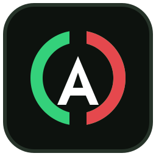

# Mobile Agent Dashboard

A gamified operator dashboard that treats your work like a character sheet:
**21 skills** charging toward Full Charge on an exponential XP curve, a
**quest book**, a **28-slot inventory**, an **agent-ops station floor**, and
a **task log** that is the proof behind every level. Nothing charges up on
claims — XP is earned only from logged, completed work.

This is the **template edition**: a single self-contained `index.html` with
demo data, ready to fork and make your own. No build step, no dependencies,
no accounts, no tracking. All data lives in your browser's `localStorage`.

## Why a phone dashboard?

Agent dashboards already exist — for the PC. Station-style desktops, local
agent harnesses, and ops views all assume you're sitting at a computer. But
the agent in most people's pocket lives on their phone. This dashboard is
built phone-first: your agent's skills, quests, and proof of work, one thumb
away.

It was initially designed and built with **Muse** — on iPhone, Muse is
the agent people actually run day to day (there is no Hermes app for iOS;
other agents reach the phone through their own chat apps, like Grok). The
dashboard itself stays agent-agnostic: whatever agent you run, on whatever
device, can drive it.

## Works with any agent

This dashboard is agent-agnostic by design. Use it with a hosted agent, a
local agent framework, a custom script, or no agent at all. Plug in your own
setup by editing `CONFIG` (operator and station names, plus the goal) and
the `ZONES` list in `index.html` so the station floor matches how you work.

It stays a standalone static page: demo data only, no accounts, no tracking,
and no phoning home. Work you enter stays in your browser's `localStorage`.



## Features

- **Profile** — operator card with logo, total level medallion, HP-style
  money-goal bar with an editable goal (name, target, earned).
- **Skills** — 21 business/operator skills in four schools. Click any skill
  for the full detail panel: total XP, the exact XP math for the current and
  next level, and the complete task history behind the level.
- **Quest Book** — one quest line per project, with status, objective,
  checkable steps, reward, and deadline.
- **Inventory** — a 28-slot grid for project pieces you want visible: drafts,
  files, decisions, leads, key dates, assets. Click a slot for full details.
- **Agent Ops (Station)** — a 12-zone station floor (Command Deck, Research
  Bay, Builder Workshop, Browser Dock, Security Vault, Outreach War Room,
  Media Studio, Data Foundry, Agent Dock, Learning Bridge, Treasury, Outbox) under
  one visible law: *Truthful telemetry — the station only shows work the
  system can prove.*
- **Task Log** — the proof ledger. Add an entry, pick a skill, award
  10 / 25 / 50 / 100 XP. Skill XP is *computed from the log*, so every level
  can be audited back to its entries.
- **Weekly** — XP earned this week (Monday–Sunday, your local time), a
  per-day chart, last week's total, and XP by skill.
- **Persistence** — everything saves automatically to `localStorage`
  under the key `mobile-agent-dashboard-template-v1`.
  A reset button restores the demo state.
- **Export / Import** — your whole dashboard (goal, task log, quests,
  items, zone reports) exports to one JSON file and imports back anywhere,
  with shape validation that fails safely. Progress survives browser
  changes and moves between phone and PC — it is no longer trapped in
  one browser.
- **Agent Live Sync** — a built-in bridge API (`window.AgentDashboard`),
  cross-tab sync, and an optional JSON feed your agent publishes, so
  progress lands on the dashboard *as work happens* — not when someone
  remembers to type it in. See "Keeping your dashboard alive" below.

## Quick start

Option 1 — just open the file:

```text
Open index.html in any modern browser. That's it.
```

Option 2 — serve it statically:

```bash
git clone https://github.com/<your-username>/mobile-agent-dashboard.git
cd mobile-agent-dashboard
python3 -m http.server 8000
# then visit http://localhost:8000
```

Option 3 — GitHub Pages: fork the repo, then go to
**Settings → Pages → Build and deployment → Deploy from a branch** and pick
your default branch with the `/ (root)` folder. Your station will be live at
`https://<your-username>.github.io/mobile-agent-dashboard/`.

## Customization

### The CONFIG object

Near the top of the `<script>` block in `index.html` there is a single
`CONFIG` object. Edit it to make the station yours:

```js
const CONFIG = {
  operatorName: "Operator",            // your operator / persona name
  operatorTitle: "Business & Finance Agent",
  stationName: "Mobile Agent Dashboard",
  goalName: "First Revenue Goal",      // default money goal
  goalTarget: 1000,                    // default goal target
  currency: "$"
};
```

The money goal can also be edited in the app itself (Profile → Update goal);
in-app edits are saved to `localStorage` and override the defaults.

### Theme tokens

Colors are CSS variables at the top of the `<style>` block (`:root`). The
palette is deliberately strict — **green, red, and white on dark neutrals**:

| Token | Role |
|---|---|
| `--bg` | App background |
| `--panel` | Card / panel background |
| `--line` | Borders |
| `--text` | Primary text (white) |
| `--muted` | Secondary text |
| `--green` | Primary accent — progress, active, healthy |
| `--red` | Highlight accent — selected, alerts, low states |

Change the tokens and the whole station follows. The logo
(`assets/logo.svg`, also inlined in the header) uses the same palette.

## The Core Charge system

Progression here is a charge metaphor for real work — no borrowed game
identity. Every skill is a **core**, and every logged task charges it.

- **Charge** is a skill's XP expressed as a share of **Full Charge**:
  13,034,431 XP, the most a single core can hold. Skill tiles and detail
  panels always show charge % alongside the level.
- Under the hood the charge accumulates on a classic exponential curve.
  Skills still advance level by level (1–99) — think of the level as the
  odometer and the charge as the fuel gauge. The total XP required for
  level *n*:

```text
xp(n) = floor( ( Σ for k = 1..n-1 of floor(k + 300 · 2^(k/7)) ) / 4 )
```

- **The Half-Charge Mark** sits at **6,517,216 XP** — the point where a
  skill has banked half of all the XP a maxed core will ever need. On an
  exponential curve that moment arrives far later than intuition says;
  past it, progress stops crawling and starts compounding. The dashboard
  flags the mark on every skill once it is crossed.
- **Full Charge** is a maxed core: 13,034,431 XP, earned one logged task
  at a time. First landmark on the way: level 2, at 83 XP.

House rules baked into the template:

- Awards are standardized: **10 / 25 / 50 / 100 XP** per logged task —
  the form, the bridge, and the feed all enforce the same sizes; no other
  award can enter the system.
- No XP for drafts, plans, or claims — only completed, logged work.
- Skill XP is the sum of that skill's task-log entries. Delete an entry and
  the XP goes with it; corrections are never silent.
- Charge rises gradually and together across skills. It's a marathon
  scale on purpose.

v1.0 saves carry over untouched — v1.1 changed the language and the
instruments, not the math.

## Keeping your dashboard alive — Agent Live Sync

Manual entry works, but a dashboard that only moves when you type into it
goes stale. v1.1 ships three built-in channels so *whatever agent you
use* can keep it current as work happens. All three write to the same
store as the UI, pass the same validation, and re-render instantly.

### 1. The in-page Agent Bridge

Any agent that can run JavaScript in the page — a browser-automation
agent, a bookmarklet, your own script — gets a global API:

```js
// Log finished work (xp must be 10, 25, 50, or 100)
AgentDashboard.logWork({
  task: "Delivered the client brief",   // what was actually finished
  skill: "Communication",               // one of the 21 skill names
  xp: 25,
  note: "brief-v2.pdf"                  // optional proof reference
});

// Move a quest: a step checkbox and/or the status
AgentDashboard.setQuestProgress({ quest: "Launch a Landing Page", step: 1, done: true });
AgentDashboard.setQuestProgress({ quest: "Launch a Landing Page", status: "Complete" });

// Report a station zone's real status (report only what's real)
AgentDashboard.setZoneStatus({ zone: "Research Bay", status: "Connected", note: "2 sources checked today" });

// Read the state, or move it wholesale
AgentDashboard.getState();
AgentDashboard.exportJSON();              // -> JSON string
AgentDashboard.importJSON(jsonString);    // -> true/false
```

Invalid input is rejected safely — the call returns `false` and nothing
changes. Give a log entry an `id` and re-sending it is a no-op, so
retries can never double-count XP.

### 2. Cross-tab sync

Open the dashboard in two tabs and they stay in lockstep: any change —
yours, the bridge's, the feed's — broadcasts to every open copy the
moment it happens (`BroadcastChannel`, with the `storage` event as
fallback).

### 3. The agent feed (optional, off by default)

The push channel for agents that can't touch your browser: your agent
publishes one JSON file anywhere reachable — a static host, a gist, a
local server — and the dashboard polls it and merges what's new.

**Honest default: this is OFF.** With `feedUrl` empty the page makes
**zero network requests**, exactly like v1.0. Turn it on with one change
in the `CONFIG` object at the top of `index.html`:

```js
feedUrl: "https://example.com/my-agent-feed.json",
feedPollSeconds: 15
```

Feed format — every section is optional, and unknown or invalid items
are skipped, never fatal:

```json
{
  "app": "mobile-agent-dashboard-feed",
  "version": 1,
  "log": [
    { "id": "2026-10-09-brief", "date": "2026-10-09",
      "task": "Delivered the client brief", "skill": "Communication",
      "xp": 25, "note": "brief-v2.pdf" }
  ],
  "quests": [
    { "title": "Launch a Landing Page", "status": "Active",
      "steps": [ { "index": 1, "done": true } ] }
  ],
  "zones": [
    { "name": "Research Bay", "status": "Connected", "note": "Working" }
  ]
}
```

Merging is idempotent by entry `id`: publish the same feed forever and
nothing double-counts; add an entry with a new `id` and it lands within
one poll interval. Give every entry an `id` — entries without one are
deduplicated by a hash of their content (date + skill + task + xp +
note), which stops double-counting but also means two genuinely
different tasks with identical text would be treated as one. A failed
or malformed feed changes nothing and retries quietly on the next poll.

**The log entry format** — the same shape everywhere (form, bridge,
feed, exports): `id` (unique string), `date` (`YYYY-MM-DD`), `task`
(what was finished), `skill` (one of the 21 skill names), `xp`
(10 / 25 / 50 / 100), `note` (optional proof reference).

One browser caveat: feed polling needs the page served over http(s) in
most browsers — opening `index.html` as a `file://` can block `fetch`.
The bridge and cross-tab sync work either way.

## Screenshots

<!-- TODO: add screenshots of your fork here.
     Suggested shots: Profile, Skills detail panel, Station floor. -->

_Screenshots coming soon — fork it, theme it, show yours._

## Project layout

```text
mobile-agent-dashboard/
├── index.html          # the entire app (HTML + CSS + JS, self-contained)
├── assets/
│   └── logo.svg        # the station logo (also inlined in index.html)
├── README.md
├── AUDIT-v1.1.md       # the v1.1 audit: findings, fixes, deferrals
├── CONTRIBUTING.md
├── CODE_OF_CONDUCT.md
├── SECURITY.md
├── CHANGELOG.md
└── LICENSE
```

## Reviews

This package was reviewed before its first public release (2026-10-09).
Both reviews are a required step before any public release.

- **Security Team review — ✅ PASS, clear to publish.** Full read of every
  file plus automated sweeps. Findings: no secrets, credentials, or keys
  anywhere; no personal data anywhere except the copyright line in
  `LICENSE`; zero external network requests (no fetches, no external
  scripts, styles, fonts, or images, no tracking or analytics); no
  dangerous code patterns (`eval`, `document.write`, and similar are
  absent); every place stored data is rendered passes through an escaping
  helper or `textContent`, so log entries, quests, and items cannot break
  out of the page — including via a hand-tampered `localStorage` payload;
  `localStorage` is the only storage used, and the storage key named in
  `SECURITY.md` matches the code exactly.
- **Coding Team review — ✅ PASS WITH FIXES, all fixes applied and
  re-verified.** Verified: the XP curve matches the reference formula
  exactly (independently recomputed at levels 2, 10, 50, 92, and 99);
  clean vanilla JS with all user strings escaped; zero external requests;
  `CONFIG` genuinely drives the operator name, title, goal, and currency;
  responsive behavior passes at phone, tablet, and desktop widths. Three
  findings were fixed before publishing: (1) a task-log validation-order
  bug that could persist a phantom entry from a whitespace-only task —
  input is now trimmed and validated before anything is stored, covered by
  an automated smoke test; (2) red accent contrast below WCAG AA — the
  active tab now uses a deep red background (8.23:1) and red text uses a
  brighter token (6.40:1 / 5.97:1 on the panel backgrounds); (3) the
  level-99 skill tile now reads "Max level" instead of a percentage.
  A final automated pass re-checked JS syntax, XP values, the palette,
  storage-key consistency across `index.html`, `README.md`, and
  `SECURITY.md`, and a 21-assertion functional smoke test — all passing.
- **v1.1 audit (2026-10-09) — findings in [AUDIT-v1.1.md](AUDIT-v1.1.md).**
  Focus: per-user progression for every fork, progression portability
  (export/import), the Core Charge reframe, and Agent Live Sync. All
  high- and medium-severity findings were fixed and are covered by an
  automated smoke test: the fresh-user loop (add work → XP and levels
  move), export → wipe → import restore, bridge/feed idempotency, and
  Half-Charge / Full-Charge label rendering.

## Contributing

Forks and pull requests are welcome — see [CONTRIBUTING.md](CONTRIBUTING.md).
Please keep the project's core constraint: **vanilla HTML/CSS/JS, one file,
no build step, no external requests.**

## License

MIT — see [LICENSE](LICENSE) for the full text.
